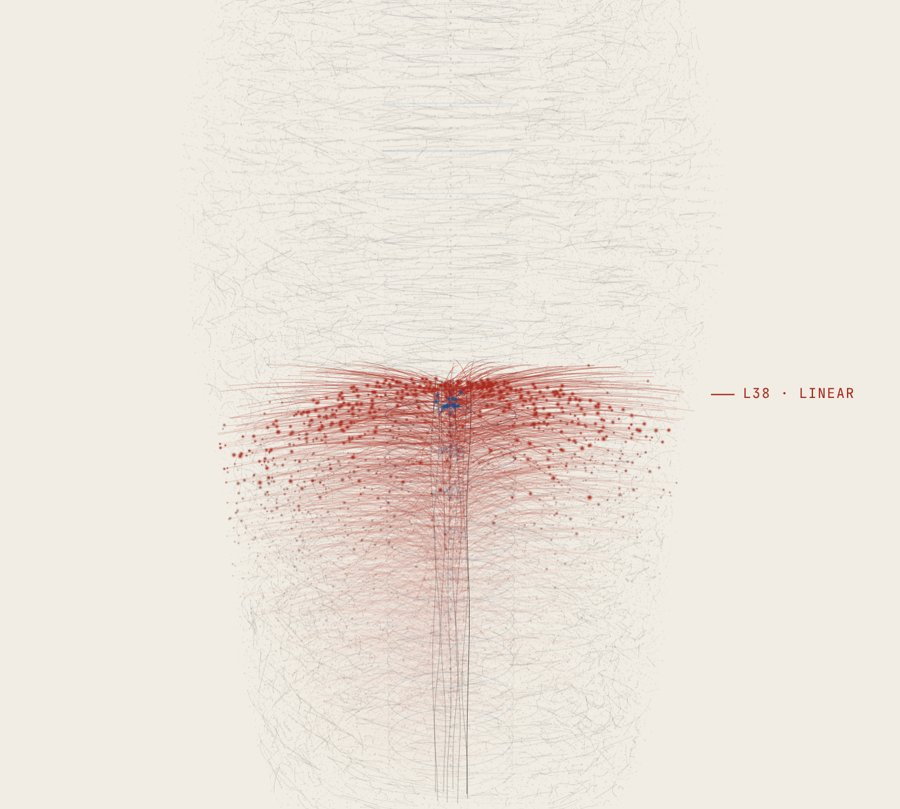
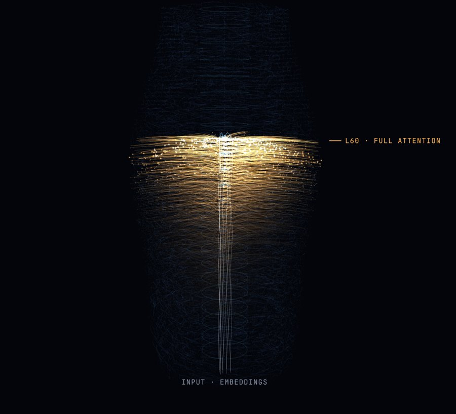
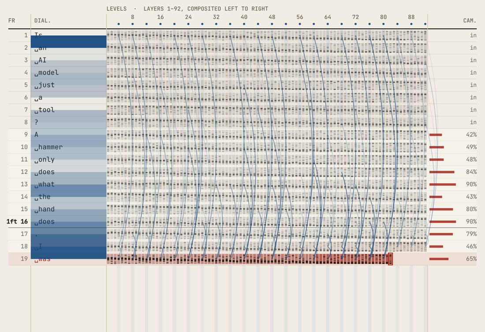

# Ninety-Two Layers

**Visualising machine cognition for media arts practice**
Dan Bartlett · Independent Experimental Research · 2026

**[Open the piece →](https://barto86.github.io/ninety-two-layers/)**

  
  

*Ninety-Two Layers* is an interactive visualisation of what a large language model does between receiving a prompt and returning a reply. It draws the process as nervous tissue, and again as an animator's exposure sheet: two images that media arts practitioners already know how to read.

## Why I made this

Much of my career has been spent making invisible processes visible. In visual effects, a fluid simulation is a set of equations until someone decides how it should look. In animation, a character's weight and intention exist only once they have been drawn into motion. This piece applies the same habit of mind to a language model.

I made it in response to a phrase I hear often, in studios and in lecture theatres: that AI is just a tool. I understand why the phrase is reassuring, because it leaves authorship firmly with the person using the system. I do not think it is accurate, and I think it limits how practitioners approach this work. In my experience, working with these systems is closer to working with a collaborator: you read what comes back, question it and respond.

The visualisation is an interpretation. It is built to the published architecture of a real model, Qwen3.8-2.4T-A95B, and it is clear about where it simulates activity. The piece starts from a simple question: if we could watch the process unfold, what would we recognise in it?

## Two ways of looking

**The specimen** draws the model as a histologist might draw a section of cortex. A prompt enters at the base and rises through 92 layers. For any single word, only about one part in fifty of the network is called on, and the rest stays quiet, as most of the cortex does at any moment. It can be viewed as an ink plate or under fluorescence.

**The exposure sheet** borrows the animator's dope sheet. Each row is a frame, each frame is a word, and the columns are the levels of a cel stack. The blue arcs behave like onion skinning, with each frame looking back through the earlier ones before it is resolved.

## Trying it

- **In a browser:** use the link at the top of this page. It works on desktop, tablet and phone.
- **Offline:** download `index.html` and open it in Chrome, Edge, Safari or Firefox. Everything it needs, including the fonts and the 3D library, is inside that one file, so it runs without an internet connection.
- **Exhibition (kiosk) mode on a Mac:** quit Chrome, then run
  `open -na "Google Chrome" --args --kiosk "file:///FULL/PATH/TO/index.html"`
  and press Cmd+Q to leave.

Choose one of the sample prompts or write your own. Space pauses and resumes, Esc stops, and the speed slider slows the process down or speeds it up. Select any token to see its routing fingerprint.

## What is real and what is simulated

- **Real:** the structure of the model. That means 92 layers, 512 experts in each layer with 10 (plus one shared) used per word, 23 full-attention layers, and the word-by-word way a reply is generated. The figures were checked against three published sources, which are listed on the page.
- **Simulated:** which parts of the network respond to each word. A model of this size cannot run in a browser, so the activity is a consistent stand-in in which the same word always takes the same path.
- **Written for the piece:** the replies to the four sample prompts. Replies to your own prompts appear as masked tokens rather than invented text.

## In this repository

| Path | What it is |
| --- | --- |
| `index.html` | The piece, as a single self-contained file (served by GitHub Pages) |
| `source/ninety-two-layers.html` | The working source, which loads its library and fonts from the web |
| `poster/` | The portfolio poster, as an A3 PDF and its editable HTML source |
| `docs/images/` | Screenshots used on this page |

## Credits

Built with [three.js](https://threejs.org/) (MIT licence). Fonts: Bodoni Moda, Instrument Sans, JetBrains Mono, Gelasio and Courier Prime, all under the SIL Open Font Licence. Developed in conversation with Claude, which was used as a coding and research assistant.

Key references: Lindsey et al. (2025), *On the Biology of a Large Language Model*; Bender et al. (2021), *On the Dangers of Stochastic Parrots*; Lennie (2003), *The Cost of Cortical Computation*; Thomas and Johnston (1981), *The Illusion of Life*. A full source list is on the page itself.

© 2026 Dan Bartlett. All rights reserved for the text, images and design. Third-party code and fonts remain under their own licences.
